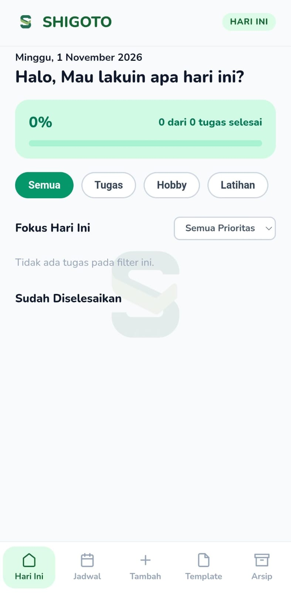
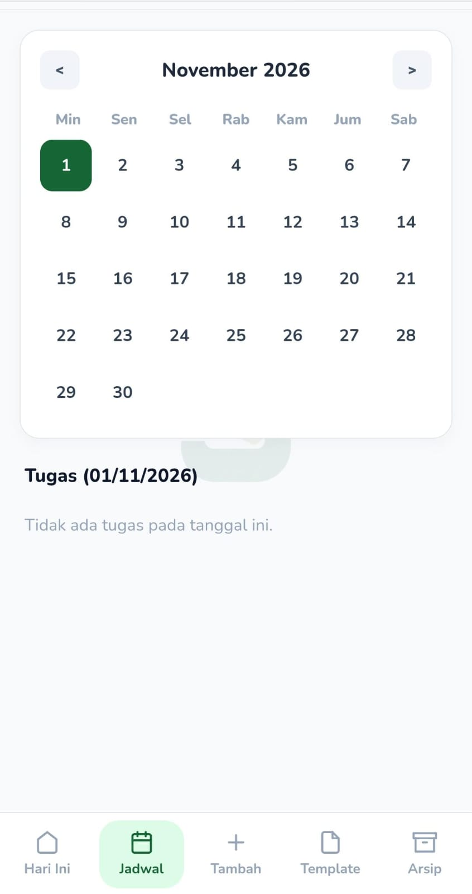
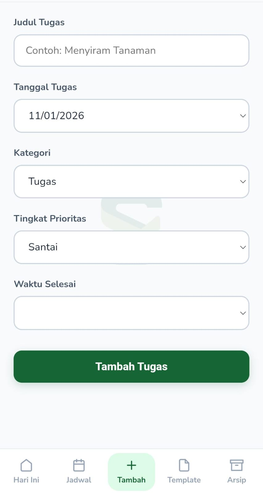
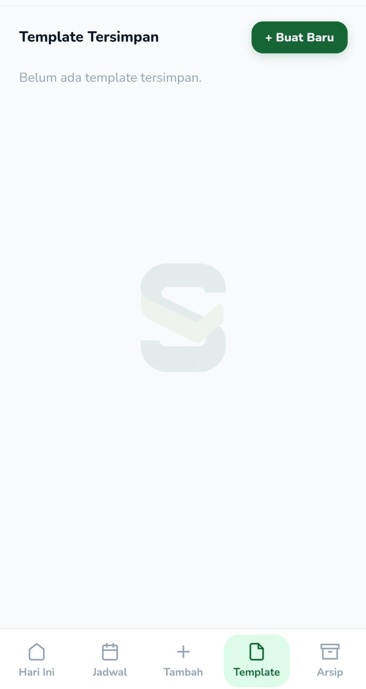
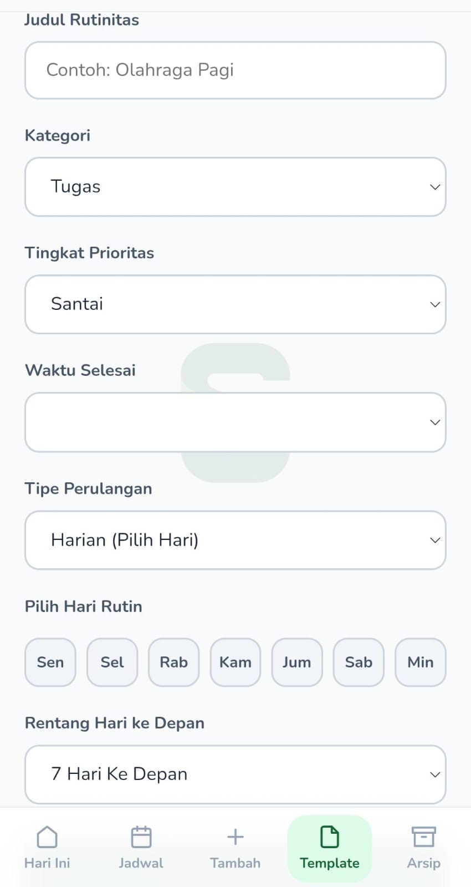
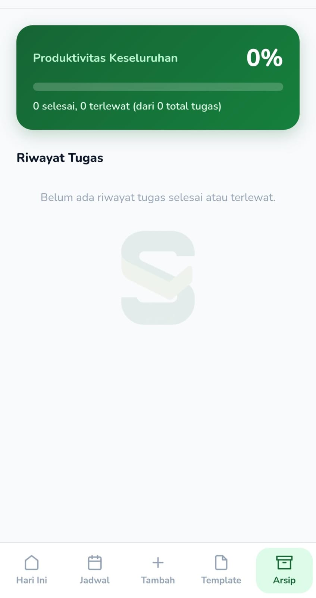

<div align="center">

  

  # SHIGOTO — Mobile-Native PWA Todo List

  **Aplikasi manajemen tugas harian yang cepat, ringan, dan fokus pada produktivitas.**

  
  
  
  

  🚀 **[Coba Aplikasi Sekarang (Live Demo)](https://shigoto-todo.netlify.app)**

</div>

---

## Tentang Proyek

**SHIGOTO** (Diambil dari bahasa Jepang 仕事 - *Pekerjaan/Tugas*) adalah aplikasi *Single Page Application* (SPA) Todo List berbasis **Vanilla JavaScript** tanpa dependensi *framework* luar. Dirancang khusus untuk pengalaman penggunaan mobile yang lancar (*GPU-accelerated animations*) dan mendukung akses *offline* menggunakan `localStorage`.

---

## Fitur Utama

-  **Hari Ini**: Fokus pada daftar tugas harian lengkap dengan ringkasan persentase kemajuan harian.
-  **Jadwal & Kalender**: Visualisasi tugas bulanan dengan sistem interaksi tanggal dan *dot indicator*.
-  **Rutinitas & Template**: Dukungan tugas berulang (Harian, Mingguan, Bulanan) yang tergenerasi otomatis.
-  **Arsip Folder Bulanan**: Pengelompokan riwayat tugas yang selesai maupun terlewat dalam format *accordion* per bulan.
-  **Tracking Produktivitas**: Statistik persentase penyelesaian seluruh tugas sepanjang waktu.
-  **Mobile-Native UI**: Transisi antar-halaman yang halus, modal konfirmasi kustom, dan responsif di semua ukuran layar.

---

## Teknologi yang Digunakan

- **Frontend**: HTML5, CSS3 (Flexbox & CSS Grid)
- **Scripting**: Vanilla JavaScript (ES6 Modules & Event-driven Architecture)
- **Storage**: Browser `localStorage` API
- **Deployment**: Netlify

---

## Struktur Proyek

```text
SHIGOTO/
├── assets/         # Logo, ikon, dan media pendukung
│   └── screenshots/# Tangkapan layar aplikasi
├── css/            # Style sheet modular per view
│   ├── global.css
│   ├── hariini.css
│   ├── kalender.css
│   ├── tambahtugas.css
│   ├── template.css
│   └── arsip.css
├── js/             # Logika aplikasi modular
│   ├── storage.js
│   ├── hariini.js
│   ├── kalender.js
│   ├── tambahtugas.js
│   ├── template.js
│   ├── arsip.js
│   └── router.js
├── .gitignore      # Daftar file/folder yang diabaikan Git
├── index.html      # Main Entry Point (SPA Layout)
└── README.md       # Dokumentasi Proyek
```

<div align="center">
  
  
  
  
  
  
</div>